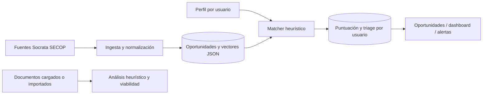

# Auditoría técnica y funcional del motor de compatibilidad de MySECOP

**Corte de la revisión:** repositorio local, rama `develop`, commit `cac56d0`.  
**Método:** inspección estática del código, modelos, configuración y pruebas existentes. No se consultaron servicios externos, bases de datos de ambientes ni datos de producción; no se ejecutaron pruebas ni mediciones de carga. Por tanto, la configuración efectiva, el contenido de las tablas, los volúmenes y el comportamiento desplegado están **No verificados**. La existencia de una columna o ruta demuestra su definición en código, no que haya datos guardados o que una migración se haya aplicado en algún ambiente.

**Convenciones:** **Hecho** = visible en el repositorio; **inferencia** = consecuencia técnica razonable que requiere medición o comprobación; **propuesta** = trabajo futuro, no implementado. «No implementado» significa que no se identificó una implementación en los componentes inspeccionados, no que se haya demostrado su inexistencia fuera del repositorio.

## 1. Resumen ejecutivo

El sistema calcula un **índice heurístico de compatibilidad**, no una probabilidad estadística de adjudicación ni una certificación de que una empresa cumple los requisitos. Combina similitud vectorial, coincidencias léxicas, UNSPSC, ubicación, cuantía, modalidad y ajustes por estado y retroalimentación (`backend/app/services/matcher.py:22`). El máximo teórico de los aportes positivos antes de recortes es 115, aunque el resultado final se limita a 100.

Los componentes que usan ese índice no aplican todos las mismas reglas: búsqueda, vista por perfil, dashboard y alertas tienen filtros y tratamientos de puntuación diferentes. El recálculo examina por defecto hasta 1.500 oportunidades sin orden explícito, de modo que no puede afirmarse que el dashboard ordene todas las oportunidades disponibles. No se ha verificado el conjunto de datos real del usuario ni se puede asegurar que exista una oportunidad concreta por encima del 50 %.

La ingesta disponible no proporciona una fecha de cierre normalizada y no se ha identificado un cursor incremental aplicado por las llamadas revisadas. Un resultado marcado como relevante no demuestra que siga abierto ni que sus pliegos estén disponibles. Hay documentos y análisis heurísticos, pero no un inventario estructurado y verificable de requisitos habilitantes.

**Conclusión:** existen piezas reutilizables para evolucionar hacia un sistema híbrido; todavía faltan datos confiables, criterios homogéneos y validación para ofrecer una compatibilidad verificable. Un ranking supervisado y probabilidades calibradas requieren primero eventos y etiquetas válidas.

## 2. Arquitectura actual



**Hecho.** Frontend Next.js/React y TypeScript; API Python/FastAPI; SQLAlchemy; PostgreSQL en Compose y configuración que también contempla SQLite; Redis y Celery para tareas; imágenes y servicios definidos en `docker-compose.yml`, dependencias en `frontend/package.json` y `backend/requirements.txt`. La búsqueda emplea consultas SQL y operaciones Python, sin implementación identificada de BM25 ni índice vectorial de búsqueda. `OpportunityEmbedding` guarda el vector como JSON (`backend/app/db/models.py`). Tener una imagen PostgreSQL con extensión vectorial disponible no demuestra que las consultas la utilicen.

La autenticación emplea usuarios y tokens; hay entidades de empresa y relaciones de pertenencia, pero el perfil y las puntuaciones del Cazador se consultan por usuario. El aislamiento integral entre organizaciones está **No verificado**: requiere pruebas de autorización para cada ruta y datos representativos. Redis es intermediario/resultado de tareas; una caché del buscador está **No implementada** en los componentes revisados. Existen registro de actividad y errores, pero métricas reales de latencia, uso y cobertura están **No verificadas**.

## 3. Inventario del perfil empresarial

`CompanyProfile` está definido en `backend/app/db/models.py:60`; `ProfileIn` en `backend/app/schemas.py:31`; lectura y actualización en `backend/app/routers/profile.py:13`; formulario en `frontend/app/(private)/app/perfil/page.tsx`. Las listas se representan en JSON; los textos, como cadenas. Las columnas del modelo están previstas para persistencia, sin verificar filas reales. «Opcional» se refiere al esquema de entrada y no garantiza calidad suficiente para el matching.

| Campo | Tipo / modelo | Obligatorio | Fuente y validación visible | Uso actual |
|---|---|---|---|---|
| `user_id` | entero / CompanyProfile | Sí, relación única | Usuario autenticado, FK | Identifica el perfil utilizado al puntuar. |
| `company_id` | entero nullable / CompanyProfile | No | FK, no se edita en `ProfileIn` | Relación organizacional; el matching revisado parte del usuario. |
| Nombre comercial, razón social, NIT | texto / CompanyProfile | No en entrada | Formulario; sin validación sustantiva de identidad observada | Identificación; no prueba capacidad jurídica. |
| Sector económico | texto / CompanyProfile | No | Texto libre | Embedding y términos del perfil. |
| Actividades principales | texto / CompanyProfile | No | Texto libre | Embedding y coincidencia temática. |
| Productos y servicios | texto / CompanyProfile | No | Texto libre | Embedding y coincidencia temática. |
| Palabras clave | lista JSON / CompanyProfile | No | Lista introducida por el usuario | Aporte léxico y filtro temático. |
| Códigos UNSPSC | lista JSON / CompanyProfile | No | Lista introducida por el usuario; no se identificó validación contra catálogo | Comparación exacta con código principal de la oportunidad. |
| Departamentos | lista JSON / CompanyProfile | No | Selección de opciones del formulario | Puntaje y filtros del perfil; comparaciones no son uniformes. |
| Municipios | lista JSON / CompanyProfile | No | Selección del formulario | Filtro de perfil; no añade puntos en `score_opportunity`. |
| Presupuesto mínimo y máximo | float / CompanyProfile | No | Entrada numérica; sin evidencia en el esquema de relación mínimo ≤ máximo | Puntaje de cuantía y filtro. |
| Modalidades preferidas | lista JSON / CompanyProfile | No | Selección del formulario | Puntaje por igualdad y filtro. |
| Experiencia | texto / CompanyProfile | No | Declaración libre | Texto del perfil en componentes de análisis; no evidencia contractual verificable. |
| Capacidades | texto / CompanyProfile | No | Declaración libre | Texto utilizado por componentes de análisis; no estados financieros estructurados. |
| Certificaciones | lista JSON / CompanyProfile | No | Lista declarada | Contexto empresarial; no validación automática de certificados. |
| Interés en consorcios | booleano / CompanyProfile | No | Formulario | Preferencia; no constituye elegibilidad jurídica. |
| `learning_weights` | JSON / CompanyProfile | No | Ajustes derivados de retroalimentación; no se identifica control equivalente en el formulario | Modifica aportes por razón. |
| `updated_at` | fecha/hora / CompanyProfile | Gestionado por sistema | Modelo | Fecha de actualización; no historial versionado. |

**Brechas.** No se identificó una estructura específica para RUP vigente, experiencia por contrato, representantes, inhabilidades, indicadores financieros u organizacionales verificables. `Document` admite un tipo relacionado con RUP y una asociación a empresa, pero eso no prueba que se haya aportado, analizado o validado un RUP real (`backend/app/db/models.py:260`, `backend/app/routers/documents.py`). No hay historial versionado del perfil identificado. La lista de localidades del formulario, los textos libres, las variantes de mayúsculas/tildes, las cuantías `float` y la ausencia de validación de UNSPSC contra catálogo dificultan consistencia y explicabilidad. Valores realmente incompletos en la base: **No verificado**.

## 4. Inventario del Cazador de Oportunidades

**Entrada:** perfil y oportunidades persistidas. **Salida:** asociación `UserOpportunity` con puntuación, razones, estado de gestión y retroalimentación (`backend/app/db/models.py`). El detalle se obtiene mediante las rutas de `backend/app/routers/opportunities.py`; frontend principal en `frontend/app/(private)/app/oportunidades/page.tsx`; dashboard en `frontend/app/(private)/app/page.tsx`; alertas en `backend/app/services/alerts.py` y `backend/app/routers/alerts.py`.

El listado admite texto, departamento, municipio, modalidad, cuantía mínima, umbral, estado de gestión y solo puntuadas. La búsqueda libre utiliza coincidencias de texto en varios campos; no se identificó BM25. En la ruta de perfil se aplican filtros estructurados, un umbral predeterminado de 40 cuando no se pide otro y una comprobación temática adicional; el dashboard solicita los cinco primeros con dicho modo y, si no encuentra resultados, puede solicitar un recálculo (`frontend/app/(private)/app/page.tsx:50`). Los resultados guardados o en proyecto pueden tener un tratamiento especial en filtros de perfil. El listado general ordena por actualización/identificador; la vista por perfil filtra y ordena por puntuación antes de paginar (`backend/app/routers/opportunities.py`).

**Diferencias relevantes:** hay más de una ruta de búsqueda y no todas interpretan igual `solo_con_score`: una admite cero y otra exige mayor que cero; algunas rutas pueden volver a consultar sin ese filtro desde el frontend. Esto puede generar resultados aparentemente contradictorios. La búsqueda combina términos con condiciones amplias y puede coincidir con palabras genéricas; por otro lado, un filtro léxico restrictivo puede excluir una relación semántica real. La comparación de tildes no es uniforme en todas las expresiones SQL. El último estado de búsqueda por usuario se persiste, pero no equivale a un historial de búsquedas (`backend/app/routers/opportunities.py:32`).

**Vigencia:** la condición SQL revisada excluye varios estados terminales, cancelaciones y publicaciones futuras, pero no comprueba `fecha_cierre` ni todos los estados que indican ejecución o cierre (`backend/app/routers/opportunities.py:43`). La ruta por perfil utiliza además `opportunity_is_current`, con reglas distintas (`backend/app/services/alerts.py`). No se puede afirmar que todos los procesos mostrados estén abiertos para presentar ofertas. La deduplicación es por fuente e identificador, no entre distintas fuentes para el mismo proceso.

## 5. Integraciones SECOP

Fuente declarada: API Socrata de datos.gov.co (`backend/app/services/secop_client.py:32`). Los siguientes identificadores son los declarados por el proyecto; su disponibilidad y contenido actual están **No verificados**.

| Fuente | Identificador / acceso | Uso y límites observados |
|---|---|---|
| SECOP II, procesos | `p6dx-8zbt`, API Socrata | Normalización a oportunidades; título, descripción, entidad, ubicación, código, modalidad, valor, estado, URL y datos originales. |
| SECOP II, contratos | `jbjy-vk9h`, API Socrata | Fuente de registros contractuales, no prueba por sí sola convocatoria abierta. |
| SECOP I | `e985-4d7e`, API Socrata | Fuente configurable; disponibilidad real no verificada. |
| Tienda Virtual del Estado Colombiano | — | **No implementado** como fuente de ingesta identificada. |

El cliente usa páginas de hasta 1.000 registros, timeout HTTP de 60 segundos y reintentos con espera para respuestas 429. El límite de páginas depende de configuración y solicitud; no implica cobertura completa. Las tareas programadas definen sincronización periódica de fuentes seleccionadas (`backend/app/workers/tasks.py`); que esté activa y su frecuencia efectiva en un servidor está **No verificado**. Aunque hay soporte para parámetros y campos de marca de agua, las llamadas revisadas no pasan `since` ni se observó persistencia efectiva de un cursor incremental; repetir la primera página puede producir muchas coincidencias existentes y dejar datos sin recorrer (`backend/app/services/ingest.py`, `backend/app/routers/sync.py`).

En registros existentes se actualiza un subconjunto de campos, por lo que descripción, clasificación o embeddings podrían quedar desactualizados. `fecha_cierre` se normaliza como ausente en el mapeo revisado (`backend/app/services/secop_client.py:199`). El JSON original se conserva, pero no equivale a un pliego ni a una fecha de cierre verificada. Los documentos pueden cargarse o importarse desde enlaces públicos reconocidos; no se garantiza acceso automático a todos los anexos, ni a documentos con sesión, restricciones o formatos incompatibles (`backend/app/routers/documents.py`). Los metadatos disponibles no bastan para validar requisitos habilitantes completos.

## 6. Modelo de datos y flujo

| Entidad | Papel y relación | Limitación para la auditoría |
|---|---|---|
| `User`, `Company`, `CompanyProfile` | Usuario, organización y perfil único por usuario; referencias de empresa. | La información real y la consistencia histórica son **No verificadas**. |
| `Opportunity` | Registro normalizado y JSON de origen; unicidad por fuente e identificador. | Sin identidad canónica entre fuentes ni garantía de fecha de cierre. |
| `OpportunityEmbedding` | Vector JSON asociado a oportunidad. | Sin versión de modelo/correspondencia garantizada con el perfil. |
| `UserOpportunity` | Estado y puntuación por usuario/oportunidad, razones y retroalimentación. | Estado actual, sin historial completo de exposiciones ni puntuaciones. |
| `Document`, análisis, proyectos y comentarios | Documentos y trabajo de preparación asociados. | Que existan tablas no demuestra documentación completa ni participación efectiva. |
| `SyncRun`, `AuditLog` | Ejecuciones y algunos eventos operativos. | No representan un registro exhaustivo de interacción o resultados de adjudicación. |

Referencias: `backend/app/db/models.py:33`, `:60`, `:100`, `:150`, `:260` y `backend/app/services/audit.py`. Los esquemas y migraciones deben contrastarse con cada base antes de usar estos campos en un modelo.

## 7. Algoritmos y fórmulas existentes

En `backend/app/services/matcher.py:22`, los pesos declarados son semántica 30, palabras clave 30, departamento 15, cuantía 15 y modalidad 10. Se añade **además** 15 por coincidencia exacta de UNSPSC. Representación resumida del cálculo actual:

```text
sem = 30 · min(1, coseno / 0,6), si coseno ≥ 0,30; en otro caso 0
léxico = 30 · min(1, coincidencias / max(1, min(3, número de términos)))
base = sem + léxico + UNSPSC + departamento + cuantía + modalidad
estado: cancelado → base − 90; estado no reconocido como abierto → base × 0,6
resultado = redondear_1_decimal(limitar_0_100(base ajustada + aprendizaje))
```

El puntaje léxico usa coincidencias extraídas de texto normalizado, con máximo de doce y saturación hasta tres. UNSPSC compara el código principal; departamento y modalidad usan coincidencia textual; municipio no se puntúa. La cuantía aporta 15 dentro del rango, penaliza algunos valores muy inferiores y puede aportar 7,5 si falta un extremo; los ceros se tratan de forma distinta por pruebas de veracidad. `learning_weights` aplica ajustes por razón con límites, después de la penalización de estado. Las razones incluyen fragmentos y explicaciones, pero no siempre prueban por sí mismos que el campo citado fue la causa exacta de la coincidencia.

**Consecuencias:** varias oportunidades pueden empatar por cuantía/ubicación o términos genéricos; una puntuación baja no significa baja probabilidad de ganar; cambios en datos o pesos pueden dejar puntuaciones previas desactualizadas. La lista de estados reconocidos es exacta y algunas variantes de escritura no reciben el mismo tratamiento. Un recorte a 100 oculta aportes superiores a 100 y no convierte el índice en probabilidad. El ajuste de aprendizaje posterior a una penalización también exige revisar casos límite.

`backend/app/services/eligibility.py` y `backend/app/agents/viability.py` implementan otras heurísticas de elegibilidad y viabilidad con reglas y pesos propios; no deben confundirse con el índice del Cazador ni presentarse como verificación completa de requisitos jurídicos o financieros. Los análisis de pliegos se apoyan en extracción de texto y patrones (`backend/app/agents/pliegos.py`), sujetos a disponibilidad y calidad del documento; OCR y análisis completo garantizado: **No implementado** en los componentes inspeccionados.

## 8. Estado de IA y búsqueda semántica

`backend/app/services/embeddings.py` implementa un proveedor local `fake` basado en hash de palabras y un proveedor opcional OpenAI; la configuración predeterminada de código es `fake`, dimensión 768 (`backend/app/core/config.py:36`). El vector basado en hash no es un modelo semántico entrenado. La presencia de una opción OpenAI no demuestra su configuración o uso en ningún ambiente; además se debe comprobar disponibilidad de la dependencia y compatibilidad dimensional del modelo y los vectores persistidos. El coseno devuelve cero cuando las dimensiones no coinciden. Provider real, dimensiones de datos existentes y tasa de errores: **No verificados**.

No se identificó búsqueda ANN/pgvector ni BM25 en el flujo revisado; los vectores se almacenan como JSON y el cálculo se realiza en Python. Se declaran opciones de proveedor LLM en configuración, pero no se identificó una llamada LLM efectiva en el cálculo de compatibilidad revisado. La generación de explicaciones heurísticas no demuestra uso de un LLM. Costos y calidad de un proveedor externo: **No verificados**.

## 9. Datos disponibles para entrenamiento y señales

| Señal | Existencia y almacenamiento | Aptitud para aprendizaje |
|---|---|---|
| Última búsqueda | JSON de último estado por usuario | Útil para restaurar interfaz; sin historial de consultas. |
| Visualizaciones y exposiciones del ranking | **No implementado** como histórico exhaustivo identificado | Faltan impresiones, posición y tiempo de exposición. |
| Guardadas, descartadas y proyectos | Estado actual de `UserOpportunity` y proyectos | Señales débiles; sin historial completo ni control de sesgo. |
| Motivo de descarte / feedback | Booleano y nota disponibles en estado actual; ajuste de pesos | Sobrescritura posible; no equivale a una etiqueta de relevancia independiente. |
| Análisis y documentos | Entidades y resultados de análisis | Señales de interés, no prueba de elegibilidad ni adjudicación. |
| Participación | Estado de proyecto puede ser declarado por el usuario | Presentación oficial y su fecha: **No verificado**. |
| Adjudicación | Pueden existir datos en JSON de la fuente | Resultado vinculado a la empresa y etiqueta confiable: **No implementado** como flujo identificado. |
| Historial de perfil y de puntuaciones | **No implementado** como versionado histórico identificado | Impide reconstruir el contexto de una recomendación antigua. |

No es posible afirmar que exista un conjunto etiquetado suficiente para LambdaMART: cantidad, representatividad, sesgos y resultados reales están **No verificados**. El primer paso es definir evento objetivo, capturar impresiones y acciones con versiones y consentimiento aplicable, y evaluar cobertura y calidad antes de entrenar.

## 10. Calidad de datos

- **Completitud y actualidad:** campos empresariales opcionales y cierre ausente en el mapeo; reingesta parcial y puntuaciones antiguas pueden desalinear vista y origen.
- **Consistencia:** variaciones de estados, departamentos, modalidades, tildes y reglas de vigencia; perfiles vacíos o solo geográficos pueden considerarse configurados en algunos flujos.
- **Duplicados:** unicidad por `(source, source_id)` no resuelve un proceso presente en varias fuentes; identificadores ausentes requieren tratamiento explícito.
- **UNSPSC:** se normaliza un código principal con validaciones sintácticas; no se demuestra catálogo vigente, cobertura, clasificación completa o validación de equivalencias.
- **Cuantías y fechas:** montos `float`, parseo que elimina comas y fechas de fuentes heterogéneas requieren normalización explícita, zona horaria y pruebas; no se verificaron valores reales.
- **Trazabilidad:** JSON de origen y algunas razones/documentos ayudan, pero faltan versión de perfil, datos y algoritmo, procedencia por campo y evidencias de requisitos. Coincidir en actividad o presupuesto no prueba habilitación.

## 11. Rendimiento

`rescore_user` (`backend/app/services/alerts.py`) selecciona hasta 1.500 oportunidades sin orden explícito y puede cargar relaciones de embeddings por oportunidad; la carga diferida y los accesos a base por fila son posibles N+1. Se recorre en memoria y se recalcula un vector de perfil; si falta un vector puede generarse durante el flujo. La vista por perfil puede materializar todos los candidatos con `query.all()`, filtrar y ordenar en Python antes de paginar. El dashboard puede disparar un recálculo cuando no hay resultados. La ingesta consulta/actualiza registros individualmente y puede generar un vector por alta. Son **riesgos inferidos del código**, no tiempos medidos.

No se dispone de perfiles de consultas, cardinalidades, consumo ni benchmarks de esta revisión. Propuesta: medir p50/p95/p99, número de consultas y memoria con datos representativos; revisar planes SQL y los índices existentes antes de añadir índices o tecnología. Aislar recálculo en tareas controladas, usar lotes y reglas de invalidez explícitas solo después de medir. Timeouts/reintentos de Socrata y proveedores externos requieren observabilidad y presupuestos de latencia.

## 12. Viabilidad matemática y estadística

| Componente | Disponible / falta | Dificultad y recomendación |
|---|---|---|
| A. Elegibilidad determinista | Hay estados y heurísticas; faltan requisitos estructurados, evidencia, vigencia y estados «cumple/no cumple/desconocido». | Alta. Empezar por reglas verificables con procedencia y revisión humana; no inferir cumplimiento por falta de información. |
| B. Índice multicriterio | Pesos y razones existentes; faltan normalización, escala, versiones, datos y evaluación por dominio. | Media-alta. Diseñar dimensiones interpretables y separar elegibilidad, relevancia y confianza. |
| C. BM25 + embeddings | Texto y vectores; faltan BM25, índice vectorial, modelo/versionado coherente y evaluación comparativa. | Alta. Probar sobre corpus y métricas, sin imponer cambio tecnológico prematuro. |
| D. LambdaMART/LightGBM | Hay señales parciales de acciones; faltan impresiones, etiquetas, consultas, posición y resultados confiables. | Alta. No entrenar hasta medir volumen, representatividad y sesgo; comparar con baseline. |
| E. Probabilidad calibrada | No se identifica objetivo supervisado ni calibración. | Alta. Definir evento observable, horizonte y población; validar temporalmente, calibración y deriva. |

Una puntuación de 70/100 puede ser una medida de similitud diseñada; solo sería una probabilidad si representara un evento definido y estuviese calibrada con resultados independientes y suficientes. La probabilidad de adjudicación, en particular, depende de factores no observados y no puede inferirse del perfil y el texto de la convocatoria por sí solos.

## 13. Matriz de brechas

| Componente | Estado actual | Brecha | Impacto | Prioridad | Evidencia técnica |
|---|---|---|---|---|---|
| Vigencia | Filtros diferentes; cierre sin normalizar | No garantiza que se pueda ofertar | Riesgo de decisiones sobre procesos vencidos | Crítica | `opportunities.py:43`, `secop_client.py:199` |
| Cobertura | Límite de recálculo y cursor no demostrado | No se ordena necesariamente todo el corpus | Omisiones y ranking sesgado | Crítica | `alerts.py`, `ingest.py` |
| Elegibilidad | Reglas heurísticas | Falta evidencia estructurada por requisito | Falsa sensación de cumplimiento | Crítica | `eligibility.py`, `pliegos.py` |
| Puntuación | Pesos y recorte | No calibrada ni versionada | Porcentaje mal interpretado | Alta | `matcher.py:22` |
| Búsqueda / alertas / dashboard | Reglas separadas | Inconsistencia de filtros y universo | Resultados distintos | Alta | `opportunities.py`, `alerts.py`, dashboard frontend |
| Documentos | Importación limitada/manual | No garantiza anexos completos ni OCR | Requisitos incompletos | Alta | `documents.py`, `agents/pliegos.py` |
| Embeddings | JSON, proveedor configurable | Dimensión, versión y calidad no verificadas | Similitudes incorrectas o nulas | Alta | `embeddings.py`, `config.py:36` |
| Eventos | Estado y auditoría parcial | Sin impresiones, posiciones ni resultados etiquetados | Ranking supervisado inviable de momento | Alta | `models.py`, `audit.py` |
| Normalización | Texto libre, UNSPSC y valores parciales | Catálogos y validaciones incompletos | Falsos positivos y negativos | Alta | `schemas.py:31`, `secop_client.py` |
| Rendimiento | Cálculo Python y cargas de candidatos | Sin benchmark ni límites demostrados | Latencia / memoria | Media | `alerts.py`, `opportunities.py` |
| Observabilidad | Logs y ejecuciones | Sin métricas de calidad del ranking demostradas | Fallas difíciles de detectar | Media | `audit.py`, `models.py` |

## 14. Riesgos

1. **Operativo:** incluir un proceso que ya no admite ofertas o excluir uno vigente, especialmente con cierre desconocido.
2. **Decisión comercial:** interpretar el índice como probabilidad de adjudicación o como cumplimiento legal.
3. **Calidad:** puntuaciones repetidas, sesgo por palabras genéricas y documentos o vectores desactualizados.
4. **Cobertura y equidad:** recálculo parcial, variaciones entre fuentes y falta de evaluación por modalidad, región o sector.
5. **Escalabilidad y disponibilidad:** cómputo en memoria, N+1 y latencia de fuentes externas sin mediciones representativas.
6. **Gobierno de datos:** sin versiones y etiquetas auditables es difícil reconstruir recomendaciones o validar modelos futuros. El aislamiento efectivo entre organizaciones y la configuración de seguridad desplegada requieren pruebas separadas.

## 15. Recomendaciones preliminares

1. **Base de datos y medición:** inventariar campos reales, cobertura y fechas de fuente en ambiente autorizado; fijar un corpus de evaluación sin información sensible y un conjunto de casos de sectores distintos.
2. **Recuperación y vigencia:** acordar una única política de estados y cierre, distinguir desconocido de abierto, registrar fuente y frescura, unificar filtros y evitar que se retiren silenciosamente. Verificar paginación, deduplicación e ingesta incremental.
3. **Perfil y elegibilidad:** validar catálogos, ubicaciones y cuantías; capturar requisitos y evidencia por separado, con estados desconocidos y trazabilidad al documento. No automatizar conclusiones jurídicas sin revisión.
4. **Índice explicable:** separar pertinencia temática, cobertura, cuantía y restricciones; evitar que atributos genéricos compensen una ausencia total de afinidad; versionar entradas, reglas y razones. Comparar dashboard, alertas y listado sobre el mismo universo.
5. **Evaluación y señales:** registrar impresiones y acciones necesarias, mantener historial y definir etiquetas; evaluar precisión por sector, cobertura, tasa de falsos positivos, ranking y estabilidad temporal.
6. **Evolución híbrida:** experimentar primero con baseline léxico y vectores versionados, medir su aporte y costo; estudiar aprendizaje de ranking y calibración solo cuando existan datos adecuados. Ninguna migración de tecnología es imprescindible sin evidencia de rendimiento y calidad.

## 16. Anexos técnicos y alcance de la inspección

**26 archivos o módulos principales inspeccionados**, agrupados así:

1. `backend/app/db/models.py`
2. `backend/app/schemas.py`
3. `backend/app/core/config.py`
4. `backend/app/routers/profile.py`
5. `backend/app/routers/opportunities.py`
6. `backend/app/routers/alerts.py`
7. `backend/app/routers/sync.py`
8. `backend/app/routers/documents.py`
9. `backend/app/services/matcher.py`
10. `backend/app/services/embeddings.py`
11. `backend/app/services/alerts.py`
12. `backend/app/services/secop_client.py`
13. `backend/app/services/ingest.py`
14. `backend/app/services/eligibility.py`
15. `backend/app/services/audit.py`
16. `backend/app/agents/pliegos.py`
17. `backend/app/agents/viability.py`
18. `backend/app/workers/tasks.py`
19. `backend/tests/test_opportunities_search.py`
20. `backend/tests/test_dashboard_ranking.py`
21. `backend/tests/test_alerts.py`
22. `frontend/app/(private)/app/perfil/page.tsx`
23. `frontend/app/(private)/app/oportunidades/page.tsx`
24. `frontend/app/(private)/app/page.tsx`
25. `frontend/package.json`
26. `docker-compose.yml`

También se consultaron referencias puntuales en dependencias y otros archivos mediante búsquedas. Las pruebas existentes se inspeccionaron como evidencia del diseño, no se ejecutaron; no constituyen una certificación del sistema desplegado. El número anterior contabiliza los archivos principales listados, no las coincidencias auxiliares. Para cualquier implementación posterior se recomienda revisar las líneas correspondientes en el commit indicado y repetir la auditoría si cambia el código.
